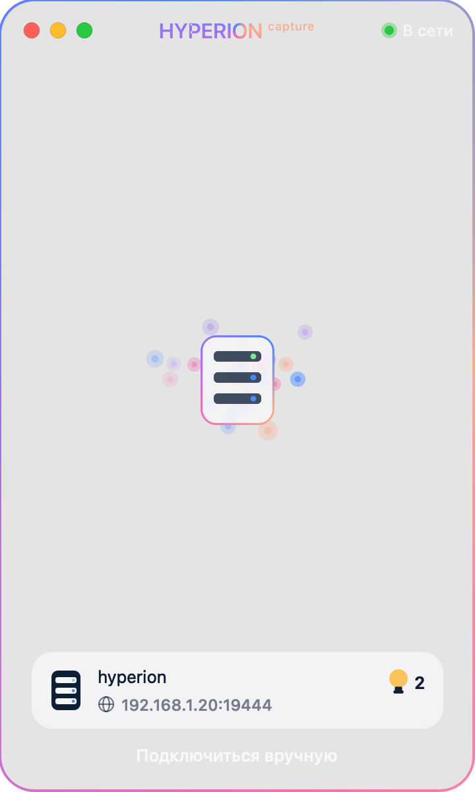
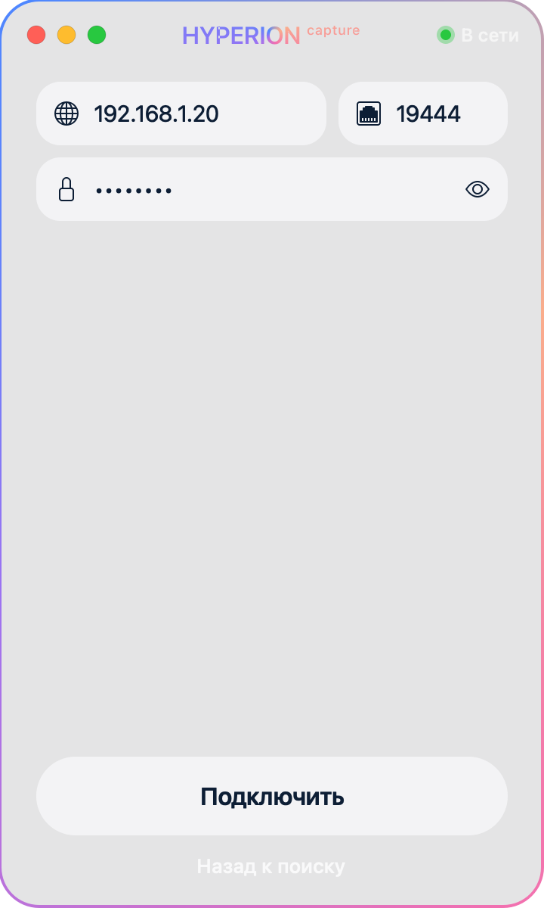
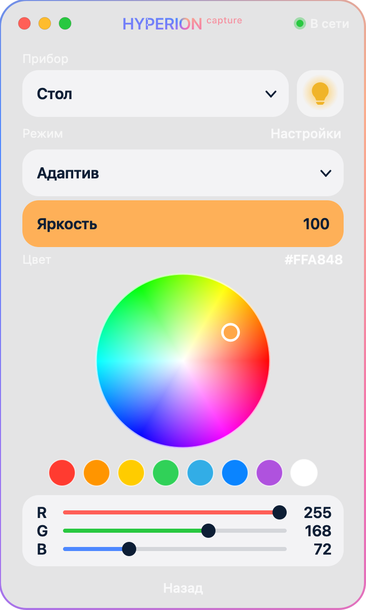
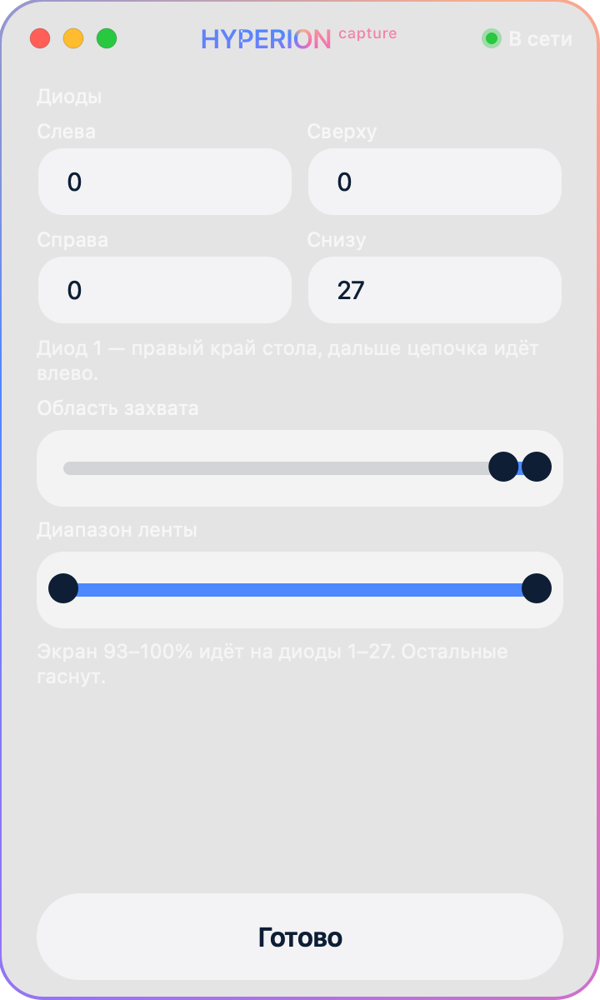

# Ampilight

Mac app that sends the screen to [Hyperion.ng](https://github.com/hyperion-project/hyperion.ng). The LED strip follows the picture. A phone running Home Assistant and this app share one Hyperion server: whoever set the color last is what the strip shows.

Ниже — как подключить захват изображения к своему Hyperion.

## Установка

Скачайте [Hyperion.dmg](https://github.com/bulai-afk/Ampilight/releases/latest). Дважды нажмите скачанный файл, затем дважды нажмите **Hyperion**. Приложение само копируется в «Программы» и открывается. Python ставить не нужно.

Если macOS скажет, что разработчик не проверен, нажмите Hyperion правой кнопкой и выберите «Открыть». Это один раз: подпись у сборки своя, без аккаунта Apple.

Дальше разрешите запись экрана и локальную сеть, выберите сервер и режим **Адаптив**. Захват экрана запускается вместе с приложением.

Кто хочет запустить из исходников, а не из установщика, читает дальше.

<p>
  
  
  
  
</p>

## Что нужно

- Hyperion.ng в одной сети с компьютером. Подойдёт Raspberry Pi или дополнение Home Assistant.
- macOS 12 или новее. Захват экрана сделан через ScreenCaptureKit и работает только на Mac.
- Python 3.11 с пакетами из `requirements.txt`.
- Лента, которую Hyperion уже умеет зажигать: ESP32 по DDP или Arduino по Adalight. Это приложение не заменяет прошивку платы, оно отдаёт Hyperion картинку.

Порт JSON API Hyperion — **19444**. Веб-интерфейс обычно на порту **8090**. Пароль по умолчанию у Hyperion — `hyperion`. Если вы его меняли, в программе нужен новый.

## 1. Hyperion

1. Откройте веб-интерфейс Hyperion и убедитесь, что экземпляр ленты включён, а устройство (LED device) запущено.
2. В настройках сети должен быть включён JSON-сервер, порт `19444`. Без него программа не подключится.
3. Запомните адрес сервера в локальной сети, например `192.168.100.7`.
4. Для стола с ESP32 устройство — `udpddp`, порт `4048`. Порядок цвета (`colorOrder`) оставьте тем, при котором заливка из самого Hyperion выглядит правильно. Для телевизора с Nano обычно Adalight на последовательном порту.
5. Раскладка диодов должна совпадать с проводом. У стола в этом проекте первый диод — правый край, цепочка идёт влево. Каждый диод — вертикальный срез кадра на всю высоту: Hyperion берёт цвет из прямоугольника, а программа заранее кладёт в него уже посчитанный цвет.

Эффект с именем **Адаптив** создавать вручную не нужно. Программа добавляет его на сервер при подключении. Это чёрная заглушка. Живая картинка приходит отдельным кадром и перекрывает заглушку.

## 2. Программа на Mac

В каталоге проекта:

```bash
python3.11 -m pip install -r requirements.txt
python3.11 -m app.hyperion_app
```

`Hyperion.app` и `Hyperion.command` запускают то же окно, но ищут Python в `~/.pyenv/versions/3.11.9`. Если pyenv с этой версией нет, пользуйтесь командой выше.

При первом запуске macOS спросит два разрешения. Оба нужны:

- **Запись экрана** — иначе захвата не будет.
- **Локальная сеть** — иначе программа не увидит Hyperion.

Разрешения лежат в «Системные настройки → Конфиденциальность и безопасность». После включения запись экрана программу надо запустить ещё раз.

Окно само прячется в строку меню. Иконка телевизора открывает превью захвата, кнопки «Запустить» / «Остановить», «Открыть» и «Выйти». Закрытие окна программу не завершает.

## 3. Подключение к серверу


1. На первом экране программа ищет Hyperion в сети. Выберите свой сервер. Если список пустой, откройте ввод адреса вручную.
2. Адрес — IP Hyperion. Порт — `19444`. Пароль — пароль JSON API.
3. Нажмите **Подключить**.

Адрес запоминается, в следующий раз программа подключается сама.

Дальше выберите прибор. Имя экземпляра в Hyperion должно быть **Стол** или **Телевизор** — по нему программа понимает, куда слать картинку. Номер экземпляра при этом может быть любым, но захват ноутбука в `app/desk_screen.py` по умолчанию смотрит на экземпляр `1`. Если стол у вас на другом номере, поменяйте `DESK` в этом файле.

## 4. Захват экрана ноутбука

Картинку стола шлёт отдельный процесс. Пока он не запущен, режим «Адаптив» только включает чёрную заглушку.

В `app/desk_screen.py` в начале файла пропишите свою сеть:

| Константа | Что это |
| --- | --- |
| `HOST` | IP Hyperion |
| `PORT` | `19444`, если не меняли |
| `PASSWORD` | пароль JSON API |
| `DESK` | номер экземпляра стола |
| `ESP_HOST` | IP платы, если он известен. Пустое значение не оставляйте: процесс всё равно ищет плату сам |
| адрес в `discover_esp` | широковещательный адрес вашей сети, сейчас там `192.168.100.255` |

Плата отвечает на UDP `4210` фразой `AMP,адрес,число_диодов`. Если адрес нашёлся, процесс сам переписывает хост DDP у экземпляра стола. Порядок цвета он не трогает.

Запуск:

```bash
python3.11 -u -m app.desk_screen
```

В выводе должно появиться `жду режим «Адаптив»`, затем `захват …%` и строки `кадр`. Окно терминала не закрывайте: вместе с ним остановится захват.

В программе выберите **Стол** и режим **Адаптив**. Лента начнёт повторять нижнюю полосу экрана.


Как это устроено в Hyperion:

- Кадр экрана идёт с приоритетом **100**. Меньшее число сильнее.
- Цвет и эффекты из этой программы и из Home Assistant идут с приоритетом **128**.
- Пока выбран «Адаптив», картинка экрана перекрывает заливку.
- Цвет, другой эффект или выключение снимают кадр. Лента не должна оставаться на последней картинке.
- Закрытая крышка гасит диоды. После открытия захват поднимается снова. Пока Mac спит, плата ещё может держать последний кадр: погасить его можно только когда компьютер проснулся.

Тёмный участок кадра гасит свой диод. Красный не подмешивается к белым бликам меню, иначе лента уходит в розовый.

### Область захвата


В настройках программы два ползунка.

**Область захвата** — вертикальная полоса экрана в процентах высоты. Для нижнего меню macOS оставьте последние несколько процентов, примерно `93–100`. Полоса выше меню на меню не реагирует.

**Диапазон ленты** — какой кусок ширины экрана растягивается на диоды. `0–100` — весь экран. Число диодов снизу должно совпадать с лентой. Подпись в окне: «Диод 1 — правый край стола, дальше цепочка идёт влево».

Ползунки читаются процессом захвата сразу, перезапускать его из‑за них не нужно.

## 5. Телевизор

На экземпляре **Телевизор** режим **Адаптив** включает граббер, который уже настроен в Hyperion (обычно USB-карта захвата, V4L). Картинку телевизора снимает сервер, не этот Mac.

Цвет и любой другой эффект граббер выключают, чтобы заливка с телефона и с компьютера была видна. Снова включить картинку телевизора — снова выбрать «Адаптив».

## 6. Если лента не повторяет экран

- В строке меню захват выключен — нажмите «Запустить» и проверьте, что в терминале идёт `app.desk_screen`.
- `Hyperion не пустил` — неверный пароль или JSON-сервер выключен.
- Список серверов пуст — Mac и Hyperion в разных сетях, либо нет разрешения на локальную сеть.
- Кадры в терминале есть, лента молчит — в Hyperion выключено устройство ленты или неверный IP платы. Процесс пишет `стол: плата …`, когда находит ESP.
- Лента белая — Hyperion смотрит не в те прямоугольники. Раскладка диодов должна быть вертикальными срезами на всю высоту кадра.
- Цвет не тот — не меняйте `colorOrder`, пока заливка одним цветом из веб-интерфейса Hyperion не станет верной. Захват пользуется тем же порядком.
- После сна картинка застыла — захват должен погасить ленту и начаться заново. Если процесс `app.desk_screen` умер, запустите его ещё раз.

## Прошивка платы

`firmware/esp32_wifi` — прошивка ESP32: Wi‑Fi, DDP на порту `4048` и ответ на поиск. Пароль сети в репозиторий не входит. В `config.h` лежат заглушки `wifi-name` и `wifi-password`. Свой пароль вводится при прошивке (`Прошить ESP32.command` или `python3 flash_esp32.py`) и остаётся только на плате.

`firmware/arduino_nano` — прошивка Adalight для телевизора. Уже прошитую плату перепрошивать не нужно.
